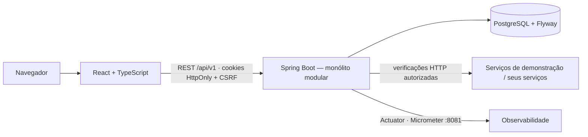

<div align="center">

# InfraWatch

**Plataforma de monitoramento de infraestrutura de TI** — disponibilidade, latência, estados e histórico de serviços e servidores **autorizados**, com verificações reais executadas pelo servidor.

Java 21 · Spring Boot 4.1 · PostgreSQL 17 · React 19 · TypeScript · Tailwind 4 · Docker

[Executar](#como-executar) · [Demonstração](#demonstração-guiada) · [Arquitetura](docs/architecture.md) · [Motor de verificações](docs/monitoring-engine.md) · [Segurança](docs/security.md) · [Progresso](PROGRESS.md)

</div>

---

## O problema

Equipes de TI, suporte e operações precisam saber **agora** se um serviço está no ar, quão rápido responde e **quando** passou a falhar — sem depender de ferramentas pagas, sem painéis com números inventados e sem transformar o monitor em um scanner de rede.

O InfraWatch centraliza isso: você cadastra os recursos que administra, o backend verifica cada um periodicamente, confirma falhas com histerese (nada de alarme por uma oscilação), registra tudo no banco e mostra indicadores calculados a partir dos dados reais.

## Funcionalidades (Fases 1 a 5 concluídas)

- **Contas e organizações** multi-tenant com perfis Administrador / Operador / Visualizador.
- **Recursos monitorados**: serviços HTTP/HTTPS e aplicações com health check, com grupo, ambiente, responsável, tags e configuração de verificação (intervalo ≥ 30 s, timeout, códigos HTTP esperados, limite de degradação, limiares de falha e recuperação).
- **Motor de verificações** agendado, concorrente e seguro (allowlist, validação de URL/DNS, bloqueio de redes internas e metadados de nuvem, redirecionamentos revalidados, limites de tempo e tamanho).
- **Estados estáveis**: Disponível, Degradado, Indisponível, Aguardando verificação, Sem dados, Em manutenção — falha comprovada é diferente de ausência de coleta.
- **Histórico**: cada verificação, cada transição de estado e cada ação administrativa (auditoria).
- **Visão Geral**: KPIs reais, disponibilidade por período, latência por serviço, distribuição de status, recursos com problemas, últimas transições.
- **Página do recurso**: gráfico de latência, verificações, histórico, configuração, "Verificar agora", pausar, editar, remover.
- **Interface** escura por padrão (modo claro disponível), sidebar recolhível, busca (Ctrl+K), skeletons, estados vazios, acessível por teclado.
- **Métricas de servidor por agente autorizado** (Fase 2): CPU, memória, disco, uptime e carga coletados por um agente leve em Java no próprio host, enviados por token com rotação/revogação; métricas não suportadas aparecem como *Indisponível*; séries brutas até 6 h e agregadas (5 min / 1 h) com retenção configurável; agente silencioso leva o recurso a *Sem dados*, nunca a *Indisponível*.
- **Tempo real** (Fase 3): WebSocket autenticado pela sessão com isolamento por organização; a interface recebe transições de estado, verificações, alertas e notificações sem recarregar, reconecta com espera progressiva e ressincroniza pela API REST.
- **Alertas** (Fase 3): regras por recurso, grupo ou organização para indisponibilidade, degradação, latência, CPU, memória, disco e falta de dados do agente, com severidade, ocorrências consecutivas, duração mínima e histerese; um único alerta por condição enquanto ela persistir; reconhecimento e resolução com auditoria.
- **Notificações internas**: sino na topbar com não lidas, geradas para indisponibilidade, recuperação, alertas, incidentes e manutenções, sem duplicidade.
- **Incidentes** (Fase 4): abertos automaticamente quando um recurso é confirmado indisponível (vinculados ao alerta) ou manualmente; status Aberto → Reconhecido → Em investigação → Resolvido → Encerrado, atribuição, comentários, causa, observações e timeline com histórico real; automáticos resolvem na recuperação, manuais nunca sozinhos; MTTR das últimas 24 h.
- **Manutenções programadas** (Fase 4): janelas por recurso com início/fim, motivo e responsável; recursos ficam "Em manutenção", alertas e incidentes são suprimidos, verificações continuam; encerramento antecipado; disponibilidade com manutenção excluída ou contada.
- **Relatórios** (Fase 5): disponibilidade por recurso e período (manutenções excluídas ou contadas, sempre declarado), tempo indisponível, verificações e falhas, latência média/p95/máxima, incidentes, MTTR, MTTA e MTBF com limitação explícita (exige ≥ 2 incidentes); evolução de latência e de CPU/memória/disco por recurso; **exportações CSV/XLSX** com histórico e download.
- **Canais externos** (Fase 5): e-mail (SMTP) e webhooks assinados (HMAC-SHA256) para destinos previamente autorizados, com fila (outbox), retentativas, deduplicação e envio **desligado por padrão** em desenvolvimento.
- **Administração** (Fase 5): convites por link de uso único, alteração de perfil, remoção de membros (último administrador protegido), recuperação de senha, auditoria com filtros; sessões persistentes (reiniciar a API não desloga).
- **Ambiente de demonstração** em Docker com três serviços HTTP controláveis deterministicamente, um container com o agente reportando métricas reais e, no perfil `observability`, Prometheus + Grafana (dashboard provisionado), Mailpit e OTel Collector.
- **Observabilidade própria**: Actuator, Micrometer (`/actuator/prometheus`), correlation id, logs estruturados, traces OpenTelemetry opcionais.

Roadmap: [Fase 6](#roadmap).

## Tecnologias

| Camada | Stack |
|---|---|
| Frontend | React 19, TypeScript, Vite 8, Tailwind CSS 4, shadcn/ui, React Router 8, TanStack Query/Table, React Hook Form + Zod, Recharts, Lucide |
| Backend | Java 21, Spring Boot 4.1 (Web MVC, Security 7, Data JPA, Validation, WebSocket, Actuator), Micrometer, Flyway, springdoc-openapi |
| Dados | PostgreSQL 17 |
| Infra | Docker, Docker Compose, GitHub Actions |
| Testes | JUnit 5, Spring Boot Test, Testcontainers, Vitest, Testing Library, Playwright |

## Arquitetura



Detalhes em [docs/architecture.md](docs/architecture.md).

## Estrutura do repositório

```
infrawatch/
├── apps/
│   ├── api/            Spring Boot (com/infrawatch/{auth,organization,resource,monitoring,metrics,alerts,notifications,incidents,maintenance,realtime,dashboard,audit,security,common,seed})
│   ├── agent/          Agente Java 21 sem dependências (CPU, RAM, disco, uptime) + Dockerfile
│   ├── web/            React + TypeScript (src/{app,components,features,hooks,layouts,pages,routes,services,types})
│   └── demo-services/  Servidor Node de demonstração (healthy / degraded / flaky)
├── e2e/                Playwright
├── docs/               architecture · monitoring-engine · alerts-and-incidents · security · observability · decisions · deploy
├── scripts/            demo.sh / demo.ps1 (controle dos cenários)
├── .github/workflows/  CI
├── docker-compose.yml  postgres + demos (+ perfil `full`: api + web)
├── .env.example
├── PROGRESS.md         estado do projeto e retomada
└── README.md
```

## Como executar

Pré-requisito: Docker Desktop. Para desenvolvimento, JDK 21 e Node 22.

**Tudo em Docker:**

```bash
cp .env.example .env
```

```bash
docker compose --profile full up -d --build
```

Abra **http://localhost:5174** e entre com `admin@demo.infrawatch.local` / `InfraWatch@2026` (seed) ou crie sua conta.

**Desenvolvimento (API e web fora do Docker):**

```bash
docker compose up -d postgres demo-healthy demo-degraded demo-flaky
```

```bash
cd apps/api && INFRAWATCH_SEED_ENABLED=true ./mvnw spring-boot:run
```

```bash
cd apps/web && npm install && npm run dev
```

Portas: web 5174 · API 8080 · Actuator 8081 (localhost) · PostgreSQL 5433 · demos 9101/9102/9103. Mais em [docs/deploy.md](docs/deploy.md).

**Com Prometheus, Grafana, Mailpit e OTel Collector** (opcional):

```bash
docker compose --profile full --profile observability up -d --build
```

Grafana em http://127.0.0.1:3000 (`admin`/`admin`), Prometheus em :9090, Mailpit em :8025. Para testar e-mails e webhooks de verdade no ambiente local, defina `INFRAWATCH_INTEGRATIONS_ENABLED=true` e `INFRAWATCH_SMTP_HOST=mailpit` no `.env`.

## Demonstração guiada

1. Entre e veja a **Visão Geral**: em poucos segundos a seed mostra *API Saudável* e *API Instável* como **Disponível** e *API Degradada* como **Degradado** (latência de ~1,8 s acima do limite de 800 ms).
2. Abra *API Instável* e derrube o serviço de demonstração:
   ```bash
   scripts/demo.sh fail
   ```
   (PowerShell: `.\scripts\demo.ps1 fail`)
3. Clique **Verificar agora** três vezes (ou aguarde 3 ciclos de 1 min). Na terceira falha o estado muda para **Indisponível** e o histórico registra "3 falha(s) consecutiva(s)".
4. Recupere:
   ```bash
   scripts/demo.sh recover
   ```
   Duas verificações depois o recurso volta a **Disponível** ("Recuperado após 2 sucesso(s)"), e a Visão Geral reflete a mudança.
5. Outros cenários: `scripts/demo.sh slow 3000` (latência), `scripts/demo.sh pattern "ok,ok,fail"` (sequência determinística), `scripts/demo.sh reset`.
6. Abra **Servidor de demonstração**: o container `infrawatch-agent-demo` reporta CPU, memória, disco e uptime a cada 15 s (etiqueta *Fonte: agente autorizado*). Pare o container (`docker stop infrawatch-agent-demo`) e, após ~45 s, o recurso passa a **Sem dados**; inicie de novo e ele volta a **Disponível**.
7. **Relatórios**: veja a disponibilidade de cada recurso com a fórmula declarada, troque o tratamento de manutenções e exporte em CSV ou XLSX (o arquivo fica no histórico).
8. **Configurações → Integrações**: crie um webhook para `http://host.docker.internal:9101/__webhook` e clique **Testar**; a entrega aparece no outbox e, com o envio habilitado, em `http://localhost:9101/__webhook/received`. Um canal de e-mail entrega no Mailpit. Em **Membros**, gere um convite e abra o link em outra janela anônima.

## Relatórios, MTTR e MTBF

Disponibilidade = tempo disponível ÷ tempo observado, só com estado conhecido; manutenções excluídas por padrão ou contadas como indisponibilidade (o relatório sempre diz qual modo usou). MTTR = média do tempo até resolver; MTBF = média do intervalo entre incidentes e só é calculado com dois ou mais incidentes no período (caso contrário o relatório explica). Detalhes e limitações em [docs/reports.md](docs/reports.md).

## Canais externos e administração

E-mail e webhooks saem de uma fila com retentativas e deduplicação, apenas para destinos autorizados pela mesma política anti-SSRF das verificações, e ficam **desligados por padrão** fora de produção. Convites, perfis, recuperação de senha e auditoria com filtros em [docs/integrations.md](docs/integrations.md).

## Como cadastrar recursos

**Recursos Monitorados → Novo recurso.** Informe nome, tipo, ambiente e a **URL autorizada**. O servidor só aceita hosts presentes na allowlist (`INFRAWATCH_ALLOWED_HOSTS`); URLs de redes internas, metadados de nuvem, com credenciais ou esquemas não HTTP são recusadas com um código de erro explícito. Configure intervalo (30 s a 24 h), timeout, códigos esperados (ex.: `200-299,301`), limite de degradação e limiares. A primeira verificação acontece em até ~5 s.

## Como funcionam os estados

Uma falha isolada **não** derruba o recurso: são necessárias `N` falhas consecutivas (padrão 3) para **Indisponível** e `M` sucessos consecutivos (padrão 2) para recuperar. Latência acima do limite por `N` coletas leva a **Degradado**. Se o InfraWatch deixar de coletar, o recurso vira **Sem dados**, não Indisponível. Resultados atrasados nunca sobrescrevem um estado mais novo. Detalhes e diagrama em [docs/monitoring-engine.md](docs/monitoring-engine.md). 

## Como funcionam os alertas

Regras definem **o que** observar (indisponível, degradado, latência, CPU, memória, disco, agente sem dados), **onde** (recurso, grupo ou toda a organização), **quando** (operador, limite, ocorrências consecutivas, duração mínima) e **com que severidade**. O motor consome os mesmos eventos que atualizam o estado dos recursos, na mesma transação: ao confirmar uma condição abre um alerta (único por regra e recurso), notifica os membros e publica por WebSocket; quando a condição normaliza, resolve automaticamente. Operadores reconhecem ou resolvem manualmente com observação, tudo auditado. Toda organização nasce com sete regras padrão editáveis. Detalhes em [docs/alerts-and-incidents.md](docs/alerts-and-incidents.md).

## Como funcionam os incidentes e as manutenções

Quando um recurso é confirmado **Indisponível**, o InfraWatch abre um incidente crítico vinculado ao alerta (um por recurso) e o resolve quando o recurso volta; a equipe também abre incidentes manuais, que só são encerrados por uma pessoa. Cada incidente tem responsável, severidade, comentários, causa e uma timeline que junta o histórico de alterações com as transições reais do recurso. **Manutenções programadas** colocam os recursos em "Em manutenção": as verificações continuam, mas nenhum alerta, incidente ou notificação é gerado; ao encerrar, o estado é recalculado pela próxima verificação. A disponibilidade informa se o tempo em manutenção foi excluído (padrão) ou contado como indisponibilidade.

**Disponibilidade** = tempo disponível ÷ tempo observado com estado conhecido × 100. Sem medições, o painel diz "Sem dados suficientes" em vez de 100%.

## Métricas de CPU, memória e disco (agente)

Verificações HTTP informam disponibilidade, código e latência. Métricas internas do servidor vêm **somente** de um agente opcional (`apps/agent`) instalado em máquinas que você administra: ele coleta via APIs padrão da JVM e `/proc/uptime`, envia para `POST /api/v1/agents/ingest` com um token exibido uma única vez (armazenado como hash, com rotação e revogação) e **não recebe comandos nem expõe acesso remoto**. O painel identifica a fonte de cada dado e mostra como *Indisponível* o que o agente não reporta. Guia em [apps/agent/README.md](apps/agent/README.md) e [docs/deploy.md](docs/deploy.md#instalar-o-agente-em-um-servidor-seu).

## Segurança

Argon2id, sessões persistentes (Spring Session JDBC) em cookie HttpOnly com renovação no login, CSRF double-submit, rate limit em autenticação e recuperação de senha, RBAC no backend, organização ativa validada no servidor, proteção contra SSRF nas verificações **e nos webhooks**, envio externo desligado por padrão, erros RFC 9457 sem vazamento interno, Actuator fora da porta pública, auditoria com filtros. Veja [docs/security.md](docs/security.md).

## Testes

```bash
cd apps/api && ./mvnw test
```
Unitários (máquina de estados, política de alvos, códigos HTTP, disponibilidade) e de integração com **PostgreSQL real via Testcontainers** (cadastro/login/sessão/CSRF, CRUD e validações, isolamento entre organizações, RBAC, motor contra um servidor HTTP embutido: falha → indisponível → recuperação, degradação, timeout, redirecionamento interno recusado, resultado fora de ordem, claim atômico).

```bash
cd apps/web && npm run test:run
```
Vitest + Testing Library: cliente HTTP (CSRF, erros), formatação, badges, login (validação, erro, sucesso), Visão Geral (dados reais, vazio, sem dados suficientes).

```bash
docker compose --profile full up -d --build && cd e2e && npm install && npx playwright install chromium && npx playwright test
```
Playwright: cadastro → recurso autorizado → verificação real → falha controlada → Indisponível → recuperação → histórico → isolamento entre organizações.

Os testes de integração da Fase 2 (`AgentIngestIT`) cobrem registro, ingestão autenticada, métricas ausentes, tokens inválidos/revogados/rotacionados, limite de frequência, defasagem de relógio, isolamento, rollup, retenção e agente silencioso. Os da Fase 3 (`AlertEngineIT`, `WebSocketIT`) cobrem regras padrão, alerta único por condição, notificações, recuperação, reconhecimento/resolução com auditoria, latência com ocorrências, regras de agente e falta de dados, validação de regras, e o canal WebSocket (eventos para a própria organização, recusa de assinatura de outra organização, handshake sem sessão).

Os da Fase 5 (`ReportsIT`, `IntegrationsIT`, `MembersIT`, `PasswordResetIT`) cobrem relatórios e exportações CSV/XLSX (inclusive proteção contra CSV injection e isolamento), canais externos (destinos recusados pela política, webhook assinado contra um servidor HTTP interno, e-mail com `JavaMailSender` simulado, retentativas/backoff, outbox), convites e membros (uso único, e-mail coincidente, último administrador) e recuperação de senha (hash, uso único, sessões em `SPRING_SESSION`). Frontend: `ReportsPage` e `IntegrationsTab`. E2E `fase5.spec.ts`: relatório + exportação, convite ponta a ponta e canal webhook.

CI em `.github/workflows/ci.yml`: build, typecheck, lint, testes, imagens Docker e E2E.

## Capturas de tela

As capturas do painel serão adicionadas em `docs/screenshots/` na Fase 6 (revisão final da interface). Vídeo de demonstração: a definir.

## Limitações atuais

- Rate limit em memória (uma instância); Redis se houver escala horizontal. Sessões já são persistentes.
- Sequência de eventos em tempo real é por instância; com várias instâncias será movida para Redis/banco.
- Métricas de CPU/RAM/disco dependem do agente autorizado; nada é inferido de respostas HTTP. O agente usa APIs da JVM: em Windows não há carga média nem uptime do SO.
- Relatórios são calculados na leitura (sem agregações materializadas); a exportação de verificações limita-se às 20 000 mais recentes do período.
- Envio externo (e-mail/webhook) fica desligado por padrão; os destinos de webhook precisam estar na allowlist.

## Roadmap

| Fase | Entrega | Status |
|---|---|---|
| 1 | Fundação e monitoramento HTTP funcional | ✅ concluída |
| 2 | Agente autorizado: CPU, RAM, disco, uptime, retenção | ✅ concluída |
| 3 | WebSocket, alertas, severidades, notificações internas | ✅ concluída |
| 4 | Incidentes, timeline, comentários, manutenções programadas | ✅ concluída |
| 5 | Relatórios (MTTR/MTBF), exportações, e-mail/webhooks, membros, auditoria avançada, Prometheus/OTel | ✅ concluída |
| 6 | Testes de concorrência e isolamento, benchmark, revisão de segurança, docs finais, screenshots | próxima |

---

Projeto de portfólio Full Stack. Projetos anteriores: Nexus CRM · DataFlow Analytics · DocMind AI.
