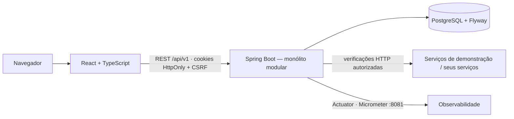

<div align="center">

# InfraWatch

**Plataforma de monitoramento de infraestrutura de TI** — disponibilidade, latência, estados e histórico de serviços e servidores **autorizados**, com verificações reais executadas pelo servidor.

Java 21 · Spring Boot 4.1 · PostgreSQL 17 · React 19 · TypeScript · Tailwind 4 · Docker

[Executar](#como-executar) · [Demonstração](#demonstração-guiada) · [Arquitetura](docs/architecture.md) · [Motor de verificações](docs/monitoring-engine.md) · [Segurança](docs/security.md) · [Progresso](PROGRESS.md)

</div>

---

## O problema

Equipes de TI, suporte e operações precisam saber **agora** se um serviço está no ar, quão rápido responde e **quando** passou a falhar — sem depender de ferramentas pagas, sem painéis com números inventados e sem transformar o monitor em um scanner de rede.

O InfraWatch centraliza isso: você cadastra os recursos que administra, o backend verifica cada um periodicamente, confirma falhas com histerese (nada de alarme por uma oscilação), registra tudo no banco e mostra indicadores calculados a partir dos dados reais.

## Funcionalidades (Fase 1 concluída)

- **Contas e organizações** multi-tenant com perfis Administrador / Operador / Visualizador.
- **Recursos monitorados**: serviços HTTP/HTTPS e aplicações com health check, com grupo, ambiente, responsável, tags e configuração de verificação (intervalo ≥ 30 s, timeout, códigos HTTP esperados, limite de degradação, limiares de falha e recuperação).
- **Motor de verificações** agendado, concorrente e seguro (allowlist, validação de URL/DNS, bloqueio de redes internas e metadados de nuvem, redirecionamentos revalidados, limites de tempo e tamanho).
- **Estados estáveis**: Disponível, Degradado, Indisponível, Aguardando verificação, Sem dados, Em manutenção — falha comprovada é diferente de ausência de coleta.
- **Histórico**: cada verificação, cada transição de estado e cada ação administrativa (auditoria).
- **Visão Geral**: KPIs reais, disponibilidade por período, latência por serviço, distribuição de status, recursos com problemas, últimas transições.
- **Página do recurso**: gráfico de latência, verificações, histórico, configuração, "Verificar agora", pausar, editar, remover.
- **Interface** escura por padrão (modo claro disponível), sidebar recolhível, busca (Ctrl+K), skeletons, estados vazios, acessível por teclado.
- **Ambiente de demonstração** em Docker com três serviços controláveis deterministicamente.
- **Observabilidade própria**: Actuator, Micrometer, correlation id, logs estruturados.

Roadmap: [Fases 2–6](#roadmap).

## Tecnologias

| Camada | Stack |
|---|---|
| Frontend | React 19, TypeScript, Vite 8, Tailwind CSS 4, shadcn/ui, React Router 8, TanStack Query/Table, React Hook Form + Zod, Recharts, Lucide |
| Backend | Java 21, Spring Boot 4.1 (Web MVC, Security 7, Data JPA, Validation, WebSocket, Actuator), Micrometer, Flyway, springdoc-openapi |
| Dados | PostgreSQL 17 |
| Infra | Docker, Docker Compose, GitHub Actions |
| Testes | JUnit 5, Spring Boot Test, Testcontainers, Vitest, Testing Library, Playwright |

## Arquitetura



Detalhes em [docs/architecture.md](docs/architecture.md).

## Estrutura do repositório

```
infrawatch/
├── apps/
│   ├── api/            Spring Boot (com/infrawatch/{auth,organization,resource,monitoring,dashboard,audit,security,common,seed})
│   ├── web/            React + TypeScript (src/{app,components,features,hooks,layouts,pages,routes,services,types})
│   └── demo-services/  Servidor Node de demonstração (healthy / degraded / flaky)
├── e2e/                Playwright
├── docs/               architecture · monitoring-engine · alerts-and-incidents · security · observability · decisions · deploy
├── scripts/            demo.sh / demo.ps1 (controle dos cenários)
├── .github/workflows/  CI
├── docker-compose.yml  postgres + demos (+ perfil `full`: api + web)
├── .env.example
├── PROGRESS.md         estado do projeto e retomada
└── README.md
```

## Como executar

Pré-requisito: Docker Desktop. Para desenvolvimento, JDK 21 e Node 22.

**Tudo em Docker:**

```bash
cp .env.example .env
```

```bash
docker compose --profile full up -d --build
```

Abra **http://localhost:5174** e entre com `admin@demo.infrawatch.local` / `InfraWatch@2026` (seed) ou crie sua conta.

**Desenvolvimento (API e web fora do Docker):**

```bash
docker compose up -d postgres demo-healthy demo-degraded demo-flaky
```

```bash
cd apps/api && INFRAWATCH_SEED_ENABLED=true ./mvnw spring-boot:run
```

```bash
cd apps/web && npm install && npm run dev
```

Portas: web 5174 · API 8080 · Actuator 8081 (localhost) · PostgreSQL 5433 · demos 9101/9102/9103. Mais em [docs/deploy.md](docs/deploy.md).

## Demonstração guiada

1. Entre e veja a **Visão Geral**: em poucos segundos a seed mostra *API Saudável* e *API Instável* como **Disponível** e *API Degradada* como **Degradado** (latência de ~1,8 s acima do limite de 800 ms).
2. Abra *API Instável* e derrube o serviço de demonstração:
   ```bash
   scripts/demo.sh fail
   ```
   (PowerShell: `.\scripts\demo.ps1 fail`)
3. Clique **Verificar agora** três vezes (ou aguarde 3 ciclos de 1 min). Na terceira falha o estado muda para **Indisponível** e o histórico registra "3 falha(s) consecutiva(s)".
4. Recupere:
   ```bash
   scripts/demo.sh recover
   ```
   Duas verificações depois o recurso volta a **Disponível** ("Recuperado após 2 sucesso(s)"), e a Visão Geral reflete a mudança.
5. Outros cenários: `scripts/demo.sh slow 3000` (latência), `scripts/demo.sh pattern "ok,ok,fail"` (sequência determinística), `scripts/demo.sh reset`.

## Como cadastrar recursos

**Recursos Monitorados → Novo recurso.** Informe nome, tipo, ambiente e a **URL autorizada**. O servidor só aceita hosts presentes na allowlist (`INFRAWATCH_ALLOWED_HOSTS`); URLs de redes internas, metadados de nuvem, com credenciais ou esquemas não HTTP são recusadas com um código de erro explícito. Configure intervalo (30 s a 24 h), timeout, códigos esperados (ex.: `200-299,301`), limite de degradação e limiares. A primeira verificação acontece em até ~5 s.

## Como funcionam os estados (e, na Fase 3, os alertas)

Uma falha isolada **não** derruba o recurso: são necessárias `N` falhas consecutivas (padrão 3) para **Indisponível** e `M` sucessos consecutivos (padrão 2) para recuperar. Latência acima do limite por `N` coletas leva a **Degradado**. Se o InfraWatch deixar de coletar, o recurso vira **Sem dados**, não Indisponível. Resultados atrasados nunca sobrescrevem um estado mais novo. Detalhes e diagrama em [docs/monitoring-engine.md](docs/monitoring-engine.md). Alertas e incidentes seguem as definições em [docs/alerts-and-incidents.md](docs/alerts-and-incidents.md).

**Disponibilidade** = tempo disponível ÷ tempo observado com estado conhecido × 100. Sem medições, o painel diz "Sem dados suficientes" em vez de 100%.

## Segurança

Argon2id, sessões em cookie HttpOnly com renovação no login, CSRF double-submit, rate limit em autenticação, RBAC no backend, organização ativa validada no servidor, proteção contra SSRF nas verificações, erros RFC 9457 sem vazamento interno, Actuator fora da porta pública, auditoria. Veja [docs/security.md](docs/security.md).

## Testes

```bash
cd apps/api && ./mvnw test
```
Unitários (máquina de estados, política de alvos, códigos HTTP, disponibilidade) e de integração com **PostgreSQL real via Testcontainers** (cadastro/login/sessão/CSRF, CRUD e validações, isolamento entre organizações, RBAC, motor contra um servidor HTTP embutido: falha → indisponível → recuperação, degradação, timeout, redirecionamento interno recusado, resultado fora de ordem, claim atômico).

```bash
cd apps/web && npm run test:run
```
Vitest + Testing Library: cliente HTTP (CSRF, erros), formatação, badges, login (validação, erro, sucesso), Visão Geral (dados reais, vazio, sem dados suficientes).

```bash
docker compose --profile full up -d --build && cd e2e && npm install && npx playwright install chromium && npx playwright test
```
Playwright: cadastro → recurso autorizado → verificação real → falha controlada → Indisponível → recuperação → histórico → isolamento entre organizações.

CI em `.github/workflows/ci.yml`: build, typecheck, lint, testes, imagens Docker e E2E.

## Capturas de tela

As capturas do painel serão adicionadas em `docs/screenshots/` na Fase 6 (revisão final da interface). Vídeo de demonstração: a definir.

## Limitações atuais

- Sessões e rate limit em memória (uma instância). Spring Session/Redis na Fase 5.
- Sem WebSocket ainda: a interface faz polling de 10–15 s (Fase 3).
- Métricas de CPU/RAM/disco dependem do agente autorizado (Fase 2); nada é inferido de respostas HTTP.
- Disponibilidade ainda não considera janelas de manutenção (Fase 4).
- Retenção/agregação de histórico chega com as amostras do agente (Fase 2).

## Roadmap

| Fase | Entrega | Status |
|---|---|---|
| 1 | Fundação e monitoramento HTTP funcional | ✅ concluída |
| 2 | Agente autorizado: CPU, RAM, disco, uptime, retenção | próxima |
| 3 | WebSocket, alertas, severidades, notificações internas | |
| 4 | Incidentes, timeline, comentários, manutenções programadas | |
| 5 | Relatórios (MTTR/MTBF), exportações, e-mail/webhooks, membros, auditoria avançada, Prometheus/OTel | |
| 6 | Testes de concorrência e isolamento, benchmark, revisão de segurança, docs finais, screenshots | |

---

Projeto de portfólio Full Stack. Projetos anteriores: Nexus CRM · DataFlow Analytics · DocMind AI.
