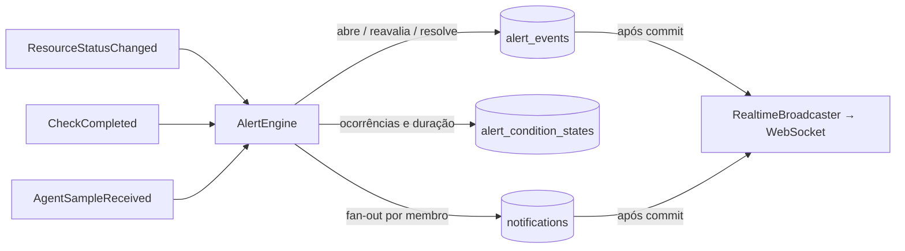

# Alertas, incidentes e disponibilidade

> Alertas (Fase 3) e incidentes/manutenções (Fase 4) ainda não foram implementados. Este documento fixa as definições que o restante do sistema já respeita.

## Disponibilidade

```
Disponibilidade (%) = tempo disponível / tempo observado × 100
```

- **Tempo observado**: soma dos intervalos em que o estado era **conhecido** (`UP`, `DEGRADED`, `DOWN`).
- **Tempo disponível**: intervalos em `UP` ou `DEGRADED` (o serviço responde, ainda que lento).
- `PENDING`, `UNKNOWN` e `MAINTENANCE` são **excluídos** do tempo observado: não contam a favor nem contra.
- Sem nenhum intervalo conhecido, o resultado é **indefinido** (`null`) e a interface mostra "Sem dados suficientes" — nunca 100%.
- A janela de um recurso começa, no máximo, na sua criação.
- O cálculo é feito a partir de `resource_status_history` (`AvailabilityCalculator`), não de contagem de verificações.

Manutenções: por padrão **excluídas** do tempo observado (`maintenance=excluded`); opcionalmente **contadas como indisponibilidade** (`maintenance=counted`). Dashboard e métricas do recurso aceitam o parâmetro e explicitam o modo.

O gráfico "Disponibilidade por período" da Visão Geral usa outra métrica, explicitada na legenda: **percentual de verificações bem-sucedidas por intervalo** (baseada em `health_check_executions`). As duas convivem porque respondem a perguntas diferentes (tempo em estado × taxa de sucesso das sondagens).

## Alertas (Fase 3 — implementado)

### Regras (`alert_rules`)

| Campo | Significado |
|---|---|
| `metric` | `STATUS_DOWN`, `STATUS_DEGRADED`, `AGENT_NO_DATA` (condições de estado) ou `LATENCY`, `CPU`, `MEMORY`, `DISK` (numéricas) — só métricas que o InfraWatch coleta |
| `operator` / `threshold` | obrigatórios nas numéricas (`>`, `≥`, `<`, `≤`); percentuais limitados a 0–100 |
| `occurrences` | violações **consecutivas** necessárias antes de abrir (padrão 1) |
| `duration_seconds` | tempo mínimo desde a primeira violação (padrão 0) |
| `severity` | Informativo, Atenção, Alto, Crítico |
| escopo | recurso específico > grupo > toda a organização |
| `enabled` | desativar resolve os alertas que a regra mantinha abertos |

Toda organização nova recebe sete regras padrão (`DefaultAlertRules`): serviço indisponível (crítico), serviço degradado (atenção), latência > 2 s ×3 (atenção), CPU > 90 % ×3 por 60 s (alto), memória > 90 % ×3 por 60 s (alto), disco > 90 % (crítico), agente sem dados (alto).

### Motor (`AlertEngine`)

Consome eventos de domínio **na mesma transação** que os originou — nunca existe alerta sem o fato persistido:



- **Estado**: ao entrar em `DOWN` / `DEGRADED` / `UNKNOWN` (agente) a regra correspondente abre; ao sair, resolve com `CONDITION_CLEARED`.
- **Numéricas**: cada leitura dentro do limite zera a contagem e resolve o alerta ativo; leituras fora incrementam `alert_condition_states` e só abrem quando `occurrences` e `duration_seconds` forem atendidos (histerese simples).
- **Supressão de duplicados**: índice único parcial `(rule_id, resource_id) WHERE status <> 'RESOLVED'`; enquanto o alerta estiver ativo, novas violações apenas atualizam `last_evaluated_at`, `value` e `occurrence_count`. Nenhuma notificação é repetida.
- **Manutenção**: transições para `MAINTENANCE` e recursos em manutenção são ignorados pelo motor; ao iniciar uma janela, alertas ativos do recurso são resolvidos com `MAINTENANCE`.

### Ciclo de vida (`alert_events`)

`OPEN` → `ACKNOWLEDGED` (operador, com observação) → `RESOLVED` (`CONDITION_CLEARED` automático, `MANUAL` por operador, `RULE_DISABLED`). Cada passo registra usuário, horário e vai para a auditoria. `notification_count` e `occurrence_count` ficam no evento.

### Notificações internas (`notifications`)

Uma linha por **membro** da organização (fan-out na mesma transação). Tipos: recurso indisponível, recurso recuperado, alerta disparado, alerta resolvido, incidente criado, incidente atribuído (só ao responsável), manutenção agendada. `dedupe_key` único por usuário evita duplicidade em reprocessamentos (padrão outbox simplificado). E-mail e webhooks (Fase 5) consumirão esta tabela.

### Tempo real

Ver [architecture.md](architecture.md#tempo-real-websocket). Eventos: `resource.status_changed`, `resource.check_completed`, `alert.triggered`, `alert.acknowledged`, `alert.resolved`, `incident.created`, `incident.updated`, `incident.resolved`, `maintenance.scheduled|updated|started|finished|cancelled`, `notification.created`.

## Incidentes (Fase 4 — implementado)

### Abertura

- **Automática** (`IncidentEngine`, após o motor de alertas na mesma transação): ao confirmar `DOWN` em um recurso com `auto_incident = true` e fora de manutenção, abre um incidente **Crítico**, origem `AUTOMATIC`, vinculado ao alerta de indisponibilidade quando existir. Índice único parcial garante **um** incidente automático ativo por recurso.
- **Manual** (`POST /incidents`, Operador+): título, descrição, severidade, recurso opcional e responsável opcional (que recebe notificação `INCIDENT_ASSIGNED`).
- Toda abertura gera notificação `INCIDENT_CREATED` para a organização, evento `incident.created` por WebSocket e entrada `CREATED` no histórico.

### Ciclo de vida

`OPEN` → `ACKNOWLEDGED` → `INVESTIGATING` → `RESOLVED` → `CLOSED`, com atalhos permitidos (`OPEN`/`ACKNOWLEDGED` → `RESOLVED`) e reabertura (`RESOLVED` → `INVESTIGATING`). As transições válidas são devolvidas pela API (`allowedTransitions`) e qualquer outra retorna `409`.

- **Automáticos** são resolvidos quando o recurso volta a `UP`/`DEGRADED` (`AUTO_RESOLVED`, causa preenchida com o motivo da recuperação). **Manuais nunca são encerrados automaticamente.**
- Cada alteração (status, responsável, severidade, causa, observações, título, descrição) gera uma linha em `incident_history` com usuário e horário; comentários ficam em `incident_comments`.
- **Timeline** (`GET /incidents/{id}`): histórico + comentários + transições de estado do recurso ocorridas entre a abertura e o encerramento — eventos reais, nunca reescritos.
- Duração = `resolved_at − opened_at` (ou até agora). **MTTR** (resumo) = média das durações dos incidentes resolvidos nas últimas 24 h; sem incidentes resolvidos o indicador é informado como indisponível. MTBF e relatórios por período ficam para a Fase 5.

## Manutenções programadas (Fase 4 — implementado)

- `POST /maintenances` (Operador+): título, motivo, início, término (≤ 30 dias), recursos, responsável. Notificação `MAINTENANCE_SCHEDULED`.
- `MaintenanceScheduler` (a cada 20 s) **inicia** janelas vencidas e **encerra** as expiradas; `POST /maintenances/{id}/finish` encerra antecipadamente (ou cancela uma agendada).
- Ao iniciar: recurso → `MAINTENANCE` (estado anterior guardado), contadores zerados, alertas ativos do recurso resolvidos com `MAINTENANCE`, transição registrada no histórico.
- Durante a janela: **verificações continuam** e são registradas (latência disponível), mas a máquina de estados mantém `MAINTENANCE`; o motor de alertas e o de incidentes ignoram o recurso; nenhuma notificação é gerada.
- Ao encerrar: recurso → `PENDING` com próxima verificação imediata; o estado real é definido pela coleta seguinte, sem herdar falhas da janela.
- **Disponibilidade**: por padrão o tempo em manutenção é **excluído** do tempo observado (`maintenance=excluded`); com `maintenance=counted` é contado como indisponibilidade. O dashboard e as métricas do recurso aceitam o parâmetro e explicitam o modo na nota.
