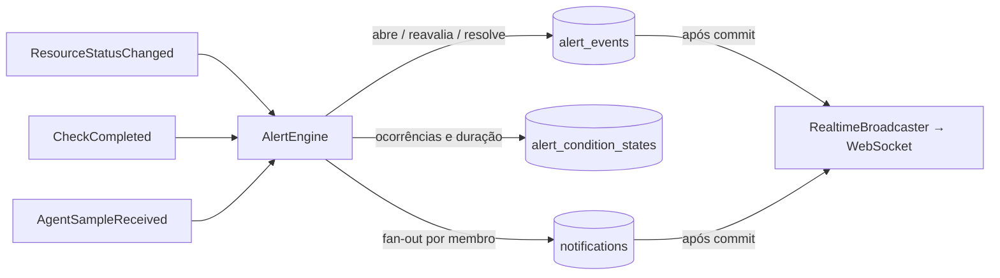

# Alertas, incidentes e disponibilidade

> Alertas (Fase 3) e incidentes/manutenções (Fase 4) ainda não foram implementados. Este documento fixa as definições que o restante do sistema já respeita.

## Disponibilidade

```
Disponibilidade (%) = tempo disponível / tempo observado × 100
```

- **Tempo observado**: soma dos intervalos em que o estado era **conhecido** (`UP`, `DEGRADED`, `DOWN`).
- **Tempo disponível**: intervalos em `UP` ou `DEGRADED` (o serviço responde, ainda que lento).
- `PENDING`, `UNKNOWN` e `MAINTENANCE` são **excluídos** do tempo observado: não contam a favor nem contra.
- Sem nenhum intervalo conhecido, o resultado é **indefinido** (`null`) e a interface mostra "Sem dados suficientes" — nunca 100%.
- A janela de um recurso começa, no máximo, na sua criação.
- O cálculo é feito a partir de `resource_status_history` (`AvailabilityCalculator`), não de contagem de verificações.

Na Fase 4, os relatórios indicarão se a disponibilidade **inclui ou exclui** janelas de manutenção (padrão: exclui, como `MAINTENANCE` já é tratado hoje).

O gráfico "Disponibilidade por período" da Visão Geral usa outra métrica, explicitada na legenda: **percentual de verificações bem-sucedidas por intervalo** (baseada em `health_check_executions`). As duas convivem porque respondem a perguntas diferentes (tempo em estado × taxa de sucesso das sondagens).

## Alertas (Fase 3 — implementado)

### Regras (`alert_rules`)

| Campo | Significado |
|---|---|
| `metric` | `STATUS_DOWN`, `STATUS_DEGRADED`, `AGENT_NO_DATA` (condições de estado) ou `LATENCY`, `CPU`, `MEMORY`, `DISK` (numéricas) — só métricas que o InfraWatch coleta |
| `operator` / `threshold` | obrigatórios nas numéricas (`>`, `≥`, `<`, `≤`); percentuais limitados a 0–100 |
| `occurrences` | violações **consecutivas** necessárias antes de abrir (padrão 1) |
| `duration_seconds` | tempo mínimo desde a primeira violação (padrão 0) |
| `severity` | Informativo, Atenção, Alto, Crítico |
| escopo | recurso específico > grupo > toda a organização |
| `enabled` | desativar resolve os alertas que a regra mantinha abertos |

Toda organização nova recebe sete regras padrão (`DefaultAlertRules`): serviço indisponível (crítico), serviço degradado (atenção), latência > 2 s ×3 (atenção), CPU > 90 % ×3 por 60 s (alto), memória > 90 % ×3 por 60 s (alto), disco > 90 % (crítico), agente sem dados (alto).

### Motor (`AlertEngine`)

Consome eventos de domínio **na mesma transação** que os originou — nunca existe alerta sem o fato persistido:



- **Estado**: ao entrar em `DOWN` / `DEGRADED` / `UNKNOWN` (agente) a regra correspondente abre; ao sair, resolve com `CONDITION_CLEARED`.
- **Numéricas**: cada leitura dentro do limite zera a contagem e resolve o alerta ativo; leituras fora incrementam `alert_condition_states` e só abrem quando `occurrences` e `duration_seconds` forem atendidos (histerese simples).
- **Supressão de duplicados**: índice único parcial `(rule_id, resource_id) WHERE status <> 'RESOLVED'`; enquanto o alerta estiver ativo, novas violações apenas atualizam `last_evaluated_at`, `value` e `occurrence_count`. Nenhuma notificação é repetida.
- **Manutenção** (Fase 4): transições para `MAINTENANCE` e recursos em manutenção são ignorados pelo motor.

### Ciclo de vida (`alert_events`)

`OPEN` → `ACKNOWLEDGED` (operador, com observação) → `RESOLVED` (`CONDITION_CLEARED` automático, `MANUAL` por operador, `RULE_DISABLED`). Cada passo registra usuário, horário e vai para a auditoria. `notification_count` e `occurrence_count` ficam no evento.

### Notificações internas (`notifications`)

Uma linha por **membro** da organização (fan-out na mesma transação). Tipos: recurso indisponível, recurso recuperado, alerta disparado, alerta resolvido (incidentes e manutenções na Fase 4). `dedupe_key` único por usuário evita duplicidade em reprocessamentos (padrão outbox simplificado). E-mail e webhooks (Fase 5) consumirão esta tabela.

### Tempo real

Ver [architecture.md](architecture.md#tempo-real-websocket). Eventos: `resource.status_changed`, `resource.check_completed`, `alert.triggered`, `alert.acknowledged`, `alert.resolved`, `notification.created`.

## Incidentes (Fase 4 — definições)

- Abertura automática na transição para `DOWN` (configurável por recurso/grupo) ou manual.
- Status: Aberto → Reconhecido → Em investigação → Resolvido → Encerrado.
- **MTTR** = média de (resolução − abertura) dos incidentes resolvidos no período.
- **MTBF** = média do tempo entre o fim de um incidente e o início do seguinte, por recurso; informado apenas quando houver ≥ 2 incidentes no período, com a limitação explícita.
- Incidente automático é resolvido quando o recurso volta a `UP`/`DEGRADED` (regra configurável); incidentes manuais nunca são encerrados automaticamente.
- A timeline preserva os eventos reais (transições, comentários, atribuições) — nada é reescrito.

## Manutenções (Fase 4 — definições)

- Durante a janela o recurso exibe `MAINTENANCE`; as verificações continuam (para registrar latência), mas transições não geram alertas/incidentes.
- Ao encerrar, o estado é recalculado pela próxima verificação (sem herdar falhas da janela).
