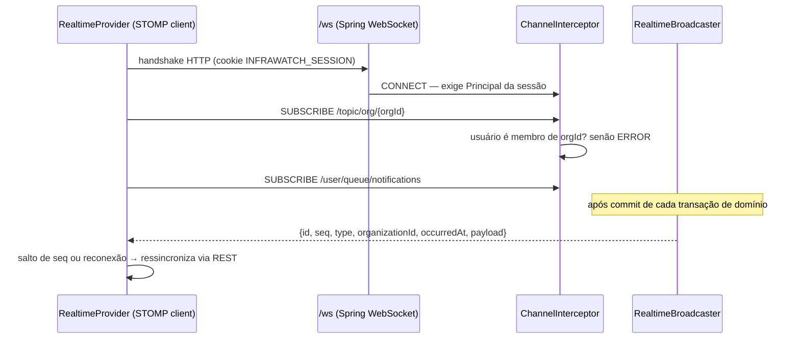

# Arquitetura

O InfraWatch é um **monólito modular**: um único serviço Spring Boot organizado por domínio, um frontend React e serviços auxiliares em Docker. A escolha evita a complexidade artificial de microsserviços e mantém o caminho de crescimento aberto (cada módulo tem controller, service, repository, DTOs e entidades próprios e conversa com os outros por serviços, não por tabelas).

```mermaid
flowchart LR
    B[Navegador] -->|HTTPS / cookies HttpOnly| W[React + TypeScript<br/>Vite · TanStack Query]
    W -->|REST /api/v1| API[Spring Boot 4.1]
    W <-->|WebSocket /ws · STOMP| API

    subgraph API [Spring Boot — monólito modular]
        AUTH[auth / organization<br/>sessões · RBAC · CSRF]
        RES[resource<br/>cadastro · política de alvos]
        MON[monitoring<br/>despachante · executor HTTP<br/>máquina de estados]
        MET[metrics<br/>agentes · amostras · rollups]
        ALR[alerts · notifications<br/>motor por eventos]
        INC[incidents · maintenance]
        REP[reports<br/>disponibilidade · MTTR/MTBF · exportações]
        INT[integrations<br/>outbox · e-mail · webhooks]
        RT[realtime<br/>broadcaster pós-commit]
        DASH[dashboard]
        AUD[audit]
        OBS[actuator · micrometer · otel]
    end

    API --> PG[(PostgreSQL 17<br/>Flyway)]
    AGT[infrawatch-agent<br/>(host do usuário)] -->|POST /agents/ingest · Bearer| API
    MON -->|verificações autorizadas| D1[demo-healthy]
    MON --> D2[demo-degraded]
    MON --> D3[demo-flaky]
    INT -->|SMTP| MAIL[Servidor SMTP<br/>(Mailpit na demo)]
    INT -->|POST JSON assinado| HOOK[Webhooks autorizados]
    OBS -->|porta 8081| PROM[Prometheus] --> GRAF[Grafana]
    OBS -.->|OTLP opcional| OTEL[OTel Collector]
```

## Módulos do backend (`apps/api/src/main/java/com/infrawatch`)

| Pacote | Responsabilidade |
|---|---|
| `common` | Exceções de API (RFC 9457), paginação, correlation id, utilitários |
| `security` | Spring Security 7: Argon2id, sessão em cookie, CSRF para SPA, rate limit, resolução da organização ativa (`CurrentContextService`) |
| `auth` | Usuário, cadastro, login/logout, `/auth/me` |
| `organization` | Organização, associação e perfis (`MemberRole`) |
| `resource` | Recursos monitorados, grupos, configuração de verificação, validação de destino |
| `monitoring` | Política de alvos (anti-SSRF), executor HTTP, despachante, avaliação de estado, histórico, métricas internas |
| `metrics` | Agentes autorizados, credenciais (hash), ingestão de amostras, rollups, retenção, leitura de métricas de CPU/RAM/disco |
| `alerts` | Regras, motor de alertas (eventos de domínio), eventos de alerta, reconhecimento/resolução |
| `notifications` | Notificações internas por usuário (fan-out, dedupe) |
| `incidents` | Incidentes automáticos/manuais, transições, comentários, histórico e timeline |
| `maintenance` | Janelas de manutenção, agendador, entrada/saída do estado `MAINTENANCE` |
| `realtime` | STOMP/WebSocket: autorização por organização, broadcaster pós-commit, envelope com sequência |
| `common.events` | Eventos de domínio (`ResourceStatusChanged`, `CheckCompleted`, `AgentSampleReceived`, `AlertChanged`, `NotificationCreated`) |
| `dashboard` | Agregações para a Visão Geral |
| `audit` | Trilha de auditoria |
| `seed` | Dados de demonstração (opcional) |

## Fluxo de uma requisição autenticada

1. `CorrelationIdFilter` gera/propaga `X-Request-Id` e coloca no MDC.
2. Cadeia do Spring Security: CORS → CSRF (cookie `XSRF-TOKEN` × cabeçalho `X-XSRF-TOKEN`) → contexto de segurança lido da sessão (`INFRAWATCH_SESSION`) → autorização por rota.
3. O controller pede a `CurrentContextService.require()` o contexto: usuário autenticado + organização ativa (atributo de sessão validado contra `organization_members`) + papel. **Nenhum `organizationId` enviado pelo cliente é confiado.**
4. Serviços aplicam regras de negócio e RBAC (`ctx.require(MemberRole.ADMIN)`), repositórios filtram sempre por `organization_id`.
5. Erros viram `ProblemDetail` (`GlobalExceptionHandler`), com `code` estável para o frontend.

## Fluxo de uma verificação

Ver [monitoring-engine.md](monitoring-engine.md).

## Frontend (`apps/web/src`)

| Pasta | Conteúdo |
|---|---|
| `app/` | Provedor de tema |
| `services/` | Cliente HTTP (`api.ts`) e endpoints tipados |
| `features/` | Autenticação (provider, guards), dashboard (KPIs, gráficos), recursos (formulário) |
| `layouts/` | `AppLayout` (sidebar + topbar), `AuthLayout` |
| `pages/` | Visão Geral, Recursos, Detalhe do recurso, Configurações, Login, Cadastro |
| `components/` | Componentes compartilhados (StatusBadge, EmptyState…) e `ui/` (shadcn) |
| `types/` | Contratos da API |

Estado de servidor com TanStack Query. A partir da Fase 3 o `RealtimeProvider` (`app/realtime.tsx`) mantém uma conexão STOMP e invalida as queries afetadas por cada evento; o polling continua como rede de segurança (10–30 s).

## Tempo real (WebSocket)



- Clientes **não publicam** (sem prefixo de aplicação; `SEND` é recusado).
- `seq` é monotônico por organização na instância; o cliente detecta perdas e invalida as queries.
- Reconexão com backoff exponencial (1 s → 30 s, com jitter). Enquanto desconectado a interface continua atualizando por polling; o indicador na topbar mostra o estado.
- No Docker o nginx faz o upgrade de `/ws`; no Vite, proxy `ws:true`.

## Decisões relevantes

Registradas em [decisions.md](decisions.md).
