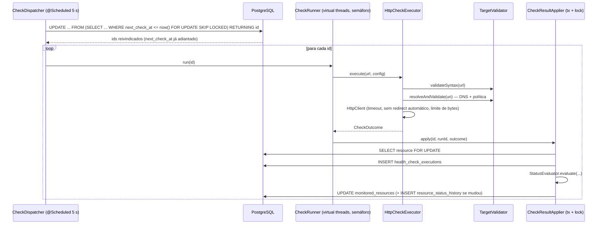
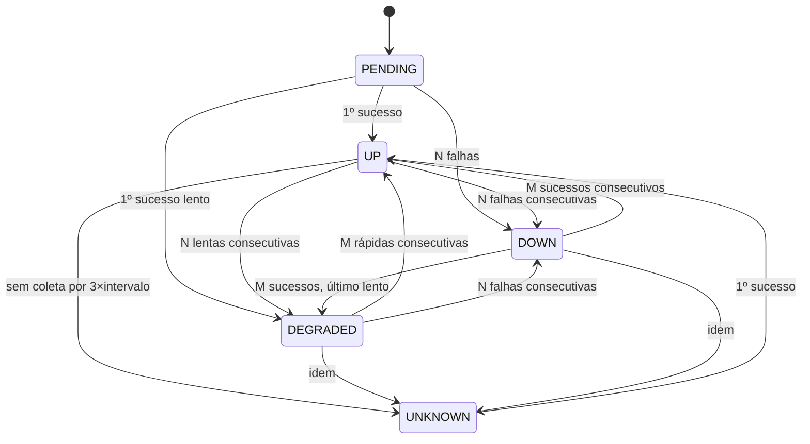

# Motor de verificações

## Visão geral

## Agendamento e concorrência

- `CheckDispatcher` roda a cada `infrawatch.monitoring.dispatcher-interval` (5 s).
- A reivindicação é **atômica no banco**: o próprio `UPDATE` adianta `next_check_at = now() + intervalo`, então duas execuções (ou duas instâncias) nunca escolhem o mesmo recurso. `FOR UPDATE SKIP LOCKED` evita bloqueios.
- O número de recursos reivindicados por ciclo é `min(batch-size, permissões livres)`. O `CheckRunner` controla um `Semaphore` com `max-concurrent-checks` (8).
- Cada verificação roda em uma *virtual thread*; a ação "Verificar agora" usa o mesmo caminho, aguardando até 5 s por uma permissão.

## Execução HTTP (`HttpCheckExecutor`)

| Proteção | Implementação |
|---|---|
| Esquema | somente `http`/`https` |
| Credenciais na URL | recusadas |
| Allowlist | `infrawatch.monitoring.target-policy.allowed-hosts` (glob, ex.: `demo-*`) |
| Portas | `allowed-ports` (vazio = qualquer) |
| DNS | resolvido antes da requisição; endereço registrado em `resolved_address` |
| Redes internas | loopback, link-local (169.254/16, metadados de nuvem), privadas (10/8, 172.16/12, 192.168/16), CGNAT (100.64/10), 0/8, 192.0.0/24, 198.18/15, ≥ 240/4, `::1`, `fc00::/7`, IPv4-mapeado — bloqueadas, **exceto** para hosts explicitamente na allowlist (serviços Docker da demo resolvem para 172.x) |
| Redirecionamentos | `followRedirects=false` por padrão; quando ativado, no máximo `max-redirects` (3) e **cada salto é revalidado** pela política |
| Timeout | por recurso (`timeout_ms`), limitado por `max-timeout-ms` (30 s) |
| Tamanho | corpo lido até `max-response-bytes` (64 KiB) e descartado — nunca persistido |
| Cabeçalhos | `User-Agent: InfraWatch-HealthCheck/1.0`; nenhum cookie/token é enviado ou gravado |
| Proxy genérico | não existe endpoint que repasse corpo/cabeçalhos de resposta ao cliente |

Resultado (`CheckOutcome`): sucesso (código HTTP dentro de `expected_status_codes`), código HTTP, tempo de resposta, `error_code` normalizado (`timeout`, `connect_timeout`, `connection_refused`, `dns_failure`, `tls_error`, `io_error`, `unexpected_status`, `unexpected_redirect`, `too_many_redirects`, `target_*`), mensagem curta e endereço resolvido.

## Máquina de estados (`StatusEvaluator`)

Códigos internos estáveis e rótulos:

| Código | Rótulo | Conhecido? | Conta como disponível? |
|---|---|---|---|
| `PENDING` | Aguardando verificação | não | — |
| `UP` | Disponível | sim | sim |
| `DEGRADED` | Degradado | sim | sim |
| `DOWN` | Indisponível | sim | não |
| `UNKNOWN` | Sem dados | não | — |
| `MAINTENANCE` | Em manutenção (Fase 4) | não | — |

Regras (parâmetros por recurso, padrões entre parênteses):

- **Falha → Indisponível** somente após `failure_threshold` (3) falhas consecutivas. Abaixo disso, o estado atual é preservado — uma falha isolada não gera transição.
- **Recuperação** a partir de Indisponível exige `recovery_threshold` (2) sucessos consecutivos; uma falha intercalada zera a contagem.
- **Degradação**: um sucesso com `response_time_ms > degraded_latency_ms` é "lento". `failure_threshold` lentos consecutivos em Disponível → Degradado; `recovery_threshold` rápidos consecutivos em Degradado → Disponível. Sem limite configurado, latência nunca degrada.
- **Primeira coleta** (Aguardando/Sem dados) → Disponível (ou Degradado se lenta) imediatamente: não há falha anterior a confirmar.
- **Sem dados**: `StaleResourceDetector` marca `UNKNOWN` quando a última verificação é mais antiga que `intervalo × stale-after-multiplier` (3). Isso distingue "o InfraWatch não coletou" de "o serviço falhou".

## Ordem e concorrência dos resultados

`CheckResultApplier.apply` bloqueia a linha do recurso (`SELECT … FOR UPDATE`). Se `outcome.startedAt <= resource.lastEvaluatedAt`, a execução é **persistida** (histórico completo) mas **não avalia estado** — um resultado atrasado nunca sobrescreve um estado mais recente. Coberto por `CheckEngineIT.staleResultDoesNotOverrideNewerState`.

## O que é gravado por verificação

`health_check_executions`: recurso, organização, `run_id`, tipo, início/fim, duração, sucesso, código HTTP, tempo de resposta, `error_code`, mensagem (≤ 500 chars), endereço resolvido. **Nunca** cookies, tokens, cabeçalhos ou corpo.

## Métricas internas (Micrometer)

`infrawatch.engine.checks.dispatched`, `infrawatch.engine.checks.executed{result,error}`, `infrawatch.engine.checks.duration{result}`, `infrawatch.engine.checks.inflight`, `infrawatch.engine.status.transitions`, `infrawatch.engine.resources.stale`. São métricas **do InfraWatch**, não dos recursos monitorados (essas vivem nas tabelas de domínio).

## Disponibilidade

Ver fórmula e tratamento em [alerts-and-incidents.md](alerts-and-incidents.md#disponibilidade) e `AvailabilityCalculator`.
